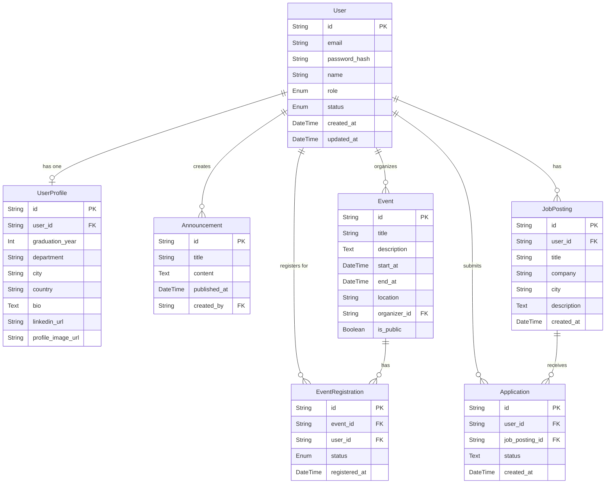

# Data Design Document

## Purpose

This project keeps a simple relational data model for a university alumni platform. The current backend already defines a minimal `User` model and an `Announcement` model, and the schema below extends those foundations for the full product.

## Core entities

### User

| Field         | Type           | Notes                                      |
| ------------- | -------------- | ------------------------------------------ |
| id            | integer identity | database-generated primary key             |
| email         | string         | unique login/contact identifier            |
| password_hash | string         | hashed password or auth provider reference |
| name          | string         | display name                               |
| role          | enum           | admin, academician, alumni, student, guest |
| status        | enum           | active, invited, suspended                 |
| created_at    | datetime       | audit field                                |
| updated_at    | datetime       | audit field                                |

### UserProfile

| Field             | Type           | Notes                         |
| ----------------- | -------------- | ----------------------------- |
| id            | integer identity | database-generated primary key |
| user_id           | FK             | links to `User`               |
| graduation_year   | integer        | optional for current students |
| department        | string         | faculty or discipline         |
| city              | string         | current city                  |
| country           | string         | current country               |
| bio               | text           | short professional summary    |
| linkedin_url      | string         | optional                      |
| profile_image_url | string         | optional                      |

### Announcement

| Field        | Type           | Notes                |
| ------------ | -------------- | -------------------- |
| id                | integer identity | database-generated primary key |
| title        | string         | headline             |
| content      | text           | body text            |
| published_at | datetime       | display date         |
| created_by   | FK             | author or admin user |

### Event

| Field        | Type           | Notes                        |
| ------------ | -------------- | ---------------------------- |
| id           | integer identity | database-generated primary key |
| title        | string         | event name                   |
| description  | text           | event details                |
| start_at     | datetime       | event start                  |
| end_at       | datetime       | event end                    |
| location     | string         | online or physical venue     |
| organizer_id | FK             | user or admin who creates it |
| is_public    | boolean        | guest-visible                |

### EventRegistration

| Field         | Type           | Notes                           |
| ------------- | -------------- | ------------------------------- |
| id            | integer identity | database-generated primary key  |
| event_id      | FK             | event being joined              |
| user_id       | FK             | registered participant          |
| status        | enum           | registered, attended, cancelled |
| registered_at | datetime       | timestamp                       |

### JobPosting

| Field       | Type             | Notes                            |
| ----------- | ---------------- | -------------------------------- |
| id          | integer identity | database-generated primary key   |
| user_id     | FK               | required posting owner          |
| title       | string           | required job title              |
| company     | string           | required employer name          |
| city        | string           | optional work city              |
| description | text             | optional long-form role details |
| created_at  | datetime         | database-generated creation date |

### Application

| Field          | Type             | Notes                            |
| -------------- | ---------------- | -------------------------------- |
| id             | integer identity | database-generated primary key   |
| user_id        | FK               | applicant                       |
| job_posting_id | FK               | applied-for job posting         |
| status         | text             | defaults to `applied`            |
| created_at     | datetime         | database-generated creation date |

## Relationships

- One `User` has one `UserProfile` and many `Announcements` or `EventRegistration` rows.
- One `User` can organize many `Event` records.
- One `Event` can have many `EventRegistration` records.
- A single `User` may register for many events.
- One user has many job postings, and each posting belongs to exactly one user.
- Users and job postings are many-to-many through applications.

## Design rules

- All user identity data should stay in `User`; profile details should remain in `UserProfile` to keep contact and personal data separate.
- Use enums for fixed role/status values to reduce invalid states.
- Keep timestamps on all mutable tables for audit and future reporting.
- Use foreign keys and constraints to prevent orphaned records.
- Deleting a user cascades to their job postings, and deleting a user or job posting cascades to its applications. This keeps dependent records from becoming orphaned and matches their ownership/dependency relationship.
- A user can apply to a job posting only once; the `(user_id, job_posting_id)` pair is unique.
- Primary keys are generated by PostgreSQL identity columns; application inserts
  must not assign `id` values.

## Initial implementation status

The repository currently includes the base models used in the NestJS backend:

- `backend/src/users/user.entity.ts` for the user resource
- `backend/src/announcements/announcement.entity.ts` for announcements

These are intentionally lightweight and are ready to expand into a fuller relational schema as the product evolves.

## Entity Relationship Diagram (ERD)

